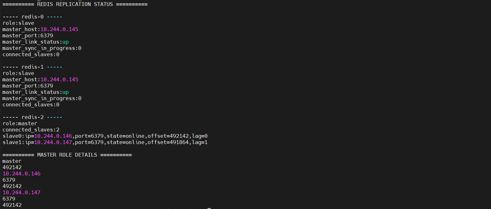
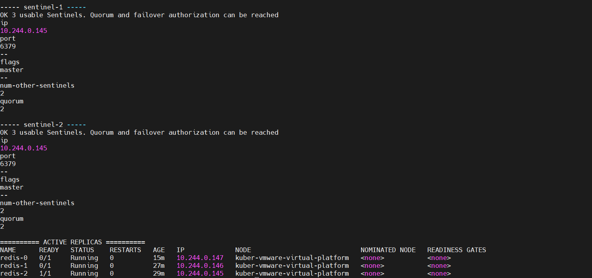
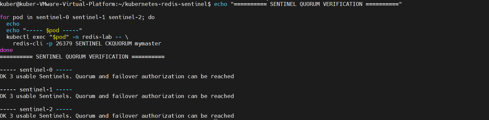
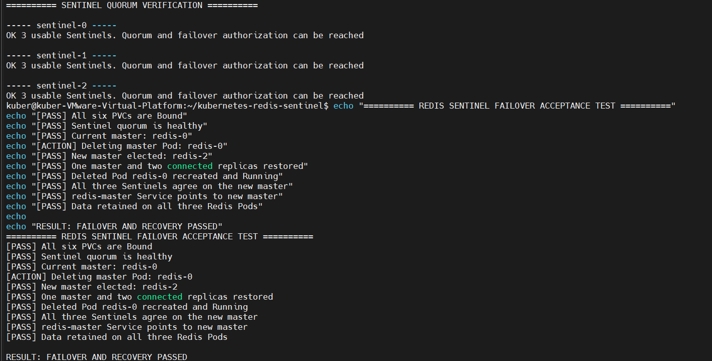
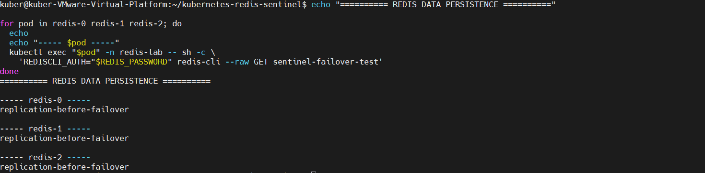
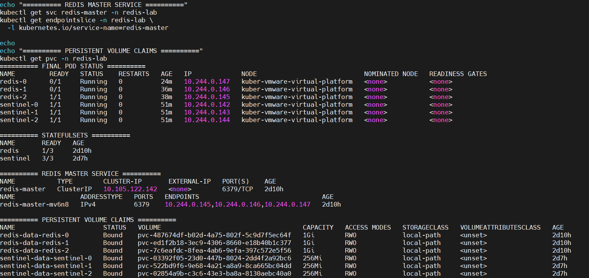

# Redis Sentinel on Kubernetes

A Kubernetes-based Redis deployment featuring StatefulSets, persistent storage, master-replica replication, and Redis Sentinel for automatic failover and recovery.

The project demonstrates Redis high availability at the **Pod level** through Sentinel-based master discovery, automatic promotion, replica recovery, and data continuity.

## Architecture

The deployment consists of:

- Three Redis instances managed by a StatefulSet.
- Three Redis Sentinel instances managed by a StatefulSet.
- Persistent Volumes for Redis data and Sentinel configuration.
- Headless Services for stable StatefulSet network discovery.
- A ClusterIP Service exposing the current Redis master.
- Redis authentication through a Kubernetes Secret.
- Redis AOF persistence and master-replica synchronization.

All workloads run on a single-node Kubernetes lab. This setup demonstrates Pod-level failover and recovery, not node-level high availability.

## Redis Replication

Three Redis instances form a replication topology with one master and two replicas. The replicas synchronize data from the current master.



## Sentinel Cluster

Three Sentinel instances monitor the Redis master and coordinate failure detection and master promotion.



### Sentinel Quorum

Sentinel quorum was verified on all three instances using `SENTINEL CKQUORUM mymaster`.

All three Sentinels reported that quorum and failover authorization were available.



## Automatic Failover and Recovery

A controlled failure test was performed by deleting the current Redis master Pod.

The test verified that:

1. Sentinel detected the master failure.
2. A replica was promoted to master.
3. Two replicas rejoined the new master.
4. The deleted Redis Pod was recreated.
5. All three Sentinels agreed on the new master.
6. The `redis-master` Service targeted the promoted master.
7. The pre-failover test key remained available on all Redis instances.

In the recorded test, `redis-0` was the initial master and `redis-2` was promoted.



## Data Persistence

A test key written before failover was verified after master promotion and Pod recreation.

The key remained available across all three Redis instances, demonstrating data continuity through the tested failover and recovery scenario.



## Final Cluster State

The final verification confirmed:

- All three Redis Pods were running.
- One Redis instance was the master.
- Two Redis instances were replicas.
- All three Sentinel Pods were running.
- All six PVCs were Bound.
- Sentinel instances agreed on the current master.

Redis readiness is intentionally master-only: replica Pods can be `Running` while showing `0/1 Ready`. This allows the `redis-master` Service to select the current master rather than replicas.



## Verified Functionality

- Three Sentinel instances discover and monitor the Redis master.
- Sentinel quorum is established.
- Redis replicas synchronize data from the master.
- Sentinel promotes a replica after master Pod failure.
- Redis instances recover their roles after Pod recreation.
- Recreated Redis replicas discover the promoted master through Sentinel.
- Sentinel discovery validates candidates using authenticated `PING` and `ROLE` commands.
- PVC-backed data survives Redis Pod recreation.
- Replication resumes with two online replicas.

See [Test Results](docs/test-results.md) for the executed acceptance and failover test scenarios.

## Repository Structure

```text
.
├── kubernetes/
│   ├── redis/
│   │   ├── redis-configmap.yaml
│   │   ├── redis-services.yaml
│   │   └── redis-statefulset.yaml
│   └── sentinel/
│       ├── sentinel-configmap.yaml
│       ├── sentinel-services.yaml
│       └── sentinel-statefulset.yaml
├── scripts/
│   ├── redis-entrypoint.sh
│   └── sentinel-entrypoint.sh
├── tests/
│   └── acceptance/
│       ├── redis-sentinel-acceptance.sh
│       └── redis-sentinel-failover.sh
└── docs/
    ├── screenshots/
    └── test-results.md
```

## Environment

| Component | Version / Configuration |
|---|---|
| Kubernetes | v1.37.0 |
| Redis | 7.4.12 |
| Operating System | Ubuntu 24.04 |
| Container Runtime | containerd 2.2.1 |
| Storage | Local Path Provisioner |
| Infrastructure | Single-node VMware virtual machine |

## Deployment

The Kubernetes cluster must have working DNS and a StorageClass named `local-path`.

Create the namespace:

```bash
kubectl create namespace redis-lab
```

Create the Redis authentication Secret:

```bash
kubectl create secret generic redis-auth \
  --namespace redis-lab \
  --from-literal=password="$(openssl rand -hex 32)"
```

Apply the Redis resources:

```bash
kubectl apply -f kubernetes/redis/redis-configmap.yaml
kubectl apply -f kubernetes/redis/redis-services.yaml
kubectl apply -f kubernetes/redis/redis-statefulset.yaml
```

Apply the Sentinel resources:

```bash
kubectl apply -f kubernetes/sentinel/sentinel-configmap.yaml
kubectl apply -f kubernetes/sentinel/sentinel-services.yaml
kubectl apply -f kubernetes/sentinel/sentinel-statefulset.yaml
```

Inspect the deployment:

```bash
kubectl get pods,pvc,services -n redis-lab
```

## Testing

Automated acceptance tests:

```bash
bash tests/acceptance/redis-sentinel-acceptance.sh
```

Controlled failover and recovery test:

```bash
bash tests/acceptance/redis-sentinel-failover.sh
```

The failover test deletes the current master Pod. Run it in a test environment where this controlled disruption is acceptable.

Detailed execution results are available in [docs/test-results.md](docs/test-results.md).

## Security and Limitations

- Redis credentials are supplied through Kubernetes Secrets.
- Credentials and generated Secret manifests must not be committed.
- Sentinel command access is currently unauthenticated and intended for internal cluster communication.
- All workloads run on a single Kubernetes node; node-level high availability is not demonstrated.
- Local-path storage is node-local and does not provide node-level storage redundancy.
- Loss of a PVC can result in data loss.
- Automated backup and disaster recovery are not implemented.
